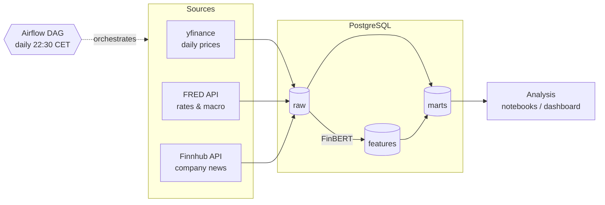
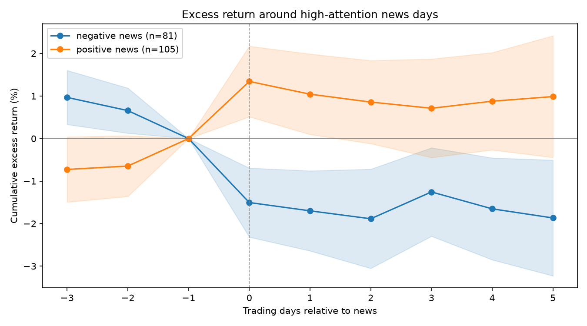
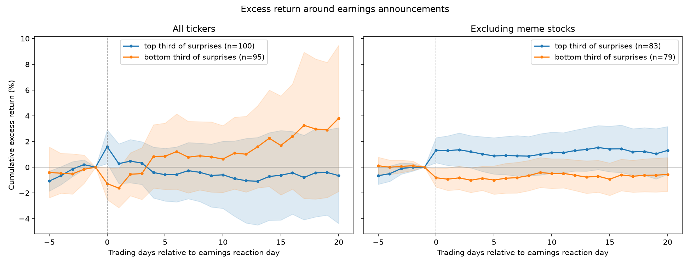

# Sentiment, Interest Rates & Stock Prices – Data Pipeline

End-to-end data pipeline that collects interest rates, macro indicators, stock prices and company news every day, scores news sentiment with a financial language model (FinBERT), and builds a daily feature table for measuring **how much each factor actually moves stock prices**.


## Architecture




The Airflow DAG runs every day after the US market close:

prices   ──┐
fred ────┼──> features ──┐
news ──> sentiment ──┘      ├──>  earnings_events
earnings ─────────────┘

## What it collects


| Source   | Data                                                                                                     | History                          |
| -------- | -------------------------------------------------------------------------------------------------------- | -------------------------------- |
| yfinance | Daily OHLCV and adjusted close for 11 stocks + SPY; quarterly EPS estimates and reported EPS             | since 2020 (earnings since 2014) |
| FRED     | 2Y and 10Y Treasury yields, 10Y-2Y spread, 10Y real yield, Fed Funds rate, VIX, high-yield credit spread | since 2020                       |
| Finnhub  | Company news headlines and summaries                                                                     | last 12 months (free plan)       |


## Getting started


### Requirements

- Docker Desktop with at least 6 GB of RAM assigned (FinBERT runs on CPU)
- Free API keys: [FRED](https://fred.stlouisfed.org/docs/api/api_key.html) and [Finnhub](https://finnhub.io/register)


### 1. Configure

```bash
cp .env.example .env
```

Fill in `.env`:

```env
FRED_API_KEY=your_fred_key
FINNHUB_API_KEY=your_finnhub_key
AIRFLOW_JWT_SECRET=any_long_random_string

POSTGRES_USER=market
POSTGRES_PASSWORD=choose_a_password
POSTGRES_DB=market_data
POSTGRES_HOST=localhost
POSTGRES_PORT=5432
```


### 2. Start the stack

```bash
docker compose up -d --build
```

This starts the market database (schemas are created automatically from `db/init/`), the Airflow metadata database, and the Airflow API server, scheduler and DAG processor.

### 3. Run the pipeline

Open the Airflow UI at [http://localhost:8081](http://localhost:8081), unpause `market_data_pipeline` and trigger it. The first run backfills about 6 years of prices and macro data, one year of news, and downloads the FinBERT model, so it takes noticeably longer than the following daily runs.

### Running without Airflow

```bash
python -m venv .venv
source .venv/bin/activate        # Windows: .venv\Scripts\Activate.ps1
pip install -r requirements.txt

python src/main.py                     # all steps
python src/main.py prices fred         # selected steps
```

Available steps: `prices`, `fred`, `news`, `sentiment`, `earnings`, `features`, `earnings_events`.

## Results


### Rate sensitivity


Excess return over SPY for a +10 bp move in the 10Y Treasury yield, with 95% Newey–West confidence intervals.
GME and AMC are excluded from the chart because their 2021 meme rally makes rate estimates meaningless; they are covered in the sentiment analysis.

- **Bond proxies lose when rates rise.** Since 2022, NEE, O and DUK fall about 0.5–0.6% more than the market for every +10 bp, with tight intervals for all three.
- **Banks still benefit, but much less.** BAC's sensitivity dropped from about +1.4% to +0.2% per 10 bp after 2022, consistent with the 2023 regional bank stress, when rising yields hurt bank bond portfolios.
- **Big tech shows no excess sensitivity.** AAPL, MSFT and NVDA make up a large share of SPY, so their rate exposure is absorbed by the market factor.
- **Fed decisions are priced like any other rate move.** On the 55 FOMC days since 2020, stocks and the 2-year yield move about 50% more than usual, but sector sensitivities to the 2-year yield are statistically the same as on other days (notebook `04_fomc`).


### News sentiment



- **Prices react to news sentiment on the same day.** A one standard deviation rise in daily sentiment goes with higher excess return for banks (+0.21%, p = 0.001), big tech (+0.25%, p = 0.024) and meme stocks (+0.68%, p < 0.001). Rate proxies show no significant effect.
- **Sentiment does not predict the next day.** Next-day effects are insignificant in every group, and Granger tests find no causality from sentiment to returns after Benjamini–Hochberg correction.
- **The move happens on day 0, partly before the news.** Around high-attention news days, returns jump about 1.4% in the direction of the sentiment and then stay flat, with no post-news drift.
- **Robustness: generic market news does not dilute the signal.** Only 24–40% of big-tech headlines mention the company itself, yet restricting sentiment to those headlines does not systematically change the results. Banks even lose signal, because sector news matters to them.


### Earnings surprises



- **Surprises move prices within two days.** Excluding meme stocks, the best quarter of a company earns about 2.8 pp more excess return over days 0–1 than its worst quarter (p = 0.011, ticker fixed effects, errors clustered by reaction date). Big tech reacts most strongly (5.6 pp, p = 0.027).
- **No post-announcement drift.** Days 2–20 show no continuation and no reversal (p = 0.71), consistent with the news results: information is priced in quickly for these liquid names.
- **Meme stocks ignore fundamentals.** GME and AMC show no relation between surprise and reaction; the apparent drift in the full sample comes from a few short-squeeze episodes.
- Surprise is measured as a within-ticker percentile rank, because Yahoo's percentage surprise explodes when the estimate is near zero and is not comparable for REITs, where analysts forecast FFO rather than EPS.


## Roadmap

- [x] Extract prices, rates and news with incremental, idempotent loads
- [x] FinBERT news sentiment
- [x] Daily features mart aligned to trading sessions
- [x] Airflow orchestration in Docker
- [x] Rate sensitivity per stock (regressions with Newey–West errors, before and after 2022)
- [x] Does sentiment predict next-day returns? (Granger tests, news volume as attention)
- [x] Market surprises: earnings vs consensus, yield moves on FOMC days
- [ ] Factor importance with scikit-learn (time-series cross-validation, permutation importance)
- [ ] Interactive dashboard: pick a stock and variables, see how they relate